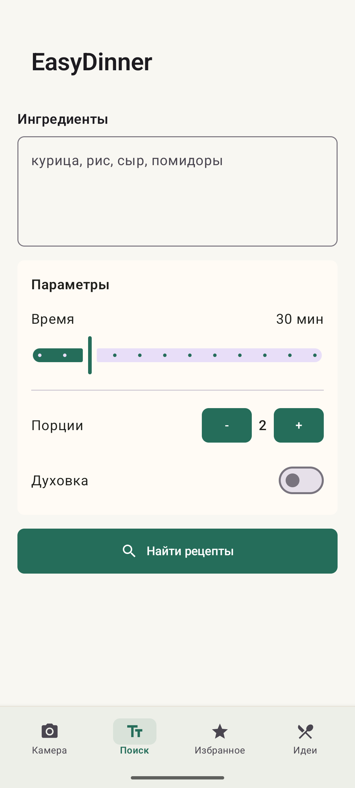
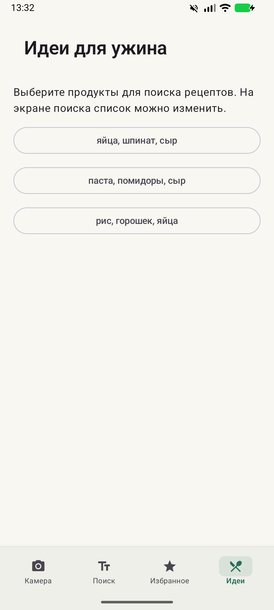
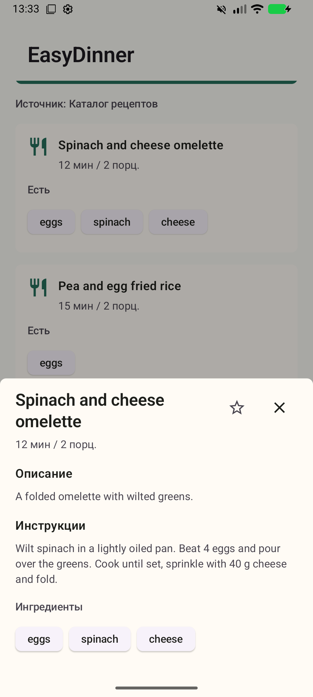
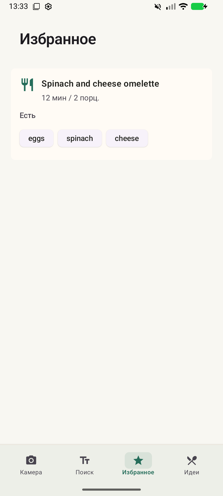

# EasyDinner

**Turn the ingredients in your kitchen into a dinner plan.** Search for recipes, see what you already have and what to buy, then keep the ones you want to cook again.

[](https://github.com/higheroffpropane/easydinner/actions/workflows/android.yml)

**Android · Kotlin · Jetpack Compose · Ktor · DataStore**

| Search | Pantry ideas | Recipe details | Saved recipes |
| :---: | :---: | :---: | :---: |
| [](docs/screens/search.png) | [](docs/screens/pantry.png) | [](docs/screens/recipe.png) | [](docs/screens/favourites.png) |

*Android emulator, Russian interface. Tap a screenshot to enlarge.*

## Try it

Start the server, run the Android client and open **Pantry**. Tap **eggs, spinach, cheese** to search the built-in catalogue. Open *Spinach and cheese omelette* to see its ingredients and directions. Tap the star to save it under **Favourites**, where it stays available after restarting the app.

| In the app | How it works |
| --- | --- |
| Ingredient search | Accepts comma-, semicolon- or newline-separated ingredients. The catalogue recognises common English and Russian names and ranks recipes by ingredients on hand. |
| Cooking preferences | Set the time available, number of portions and oven preference. In catalogue mode, directions scale to the requested portions. |
| Recipe details | Review ingredients to buy and cooking steps. Saved recipes live on the device in Preferences DataStore. |
| Camera demo | CameraX displays a preview and captures a frame on request. The demo returns an editable sample ingredient list. It does not run image recognition or upload photos. |

## Run locally

Use JDK 21 for Gradle, Android SDK **36.1** for compilation and an Android **8.0+ (API 26)** device or emulator. Gradle also uses a Java 11 toolchain, which the configured resolver can download. On Windows use `gradlew.bat` in place of `./gradlew`.

**1. Start the Ktor server** in a terminal at the repository root.

```sh
./gradlew :server:run
```

Visit [localhost:8080/health](http://localhost:8080/health). With `SPOONACULAR_API_KEY` unset, the server searches five built-in recipes. To use Spoonacular, set that environment variable in the server process before starting it. The Android client never needs the provider key.

**2. Install the debug app** from a second terminal.

```sh
./gradlew :app:installDebug
```

Launch **EasyDinner** from the device. The debug build connects to `http://10.0.2.2:8080`, the Android Emulator's route to the host machine. For a USB device, run `adb reverse tcp:8080 tcp:8080` and install with `./gradlew :app:installDebug -PEASYDINNER_DEBUG_API_BASE_URL=http://127.0.0.1:8080`. For a release build supply your HTTPS backend via `-PEASYDINNER_API_BASE_URL=https://your-host.example`.

## Inside the project

| Module | Responsibility |
| --- | --- |
| [app](app/src/main/java/com/dskochilov/easydinner) | Compose screens observe ViewModel state. A search use case normalises inputs and a repository maps the HTTP response into domain models. Koin provides dependencies. |
| [server](server/src/main/kotlin/com/dskochilov/easydinner/server) | Ktor/Netty exposes `GET /health` and `POST /recipes/search`. Providers implement one interface for the local catalogue and Spoonacular. |
| [shared](shared/src/main/kotlin/com/dskochilov/easydinner/shared) | Kotlin/JVM request and response types with Kotlin serialization, used by both client and server. |

Example search body:

```json
{
  "ingredients": ["eggs", "spinach", "cheese"],
  "preferences": { "maxReadyTimeMinutes": 20, "servings": 2, "useOven": false }
}
```

## Verify

```sh
./gradlew :server:test :app:testDebugUnitTest :app:assembleDebug
# With an emulator or device connected
./gradlew :app:connectedDebugAndroidTest
```

[Android unit tests](app/src/test/java/com/dskochilov/easydinner) cover search state, input handling and camera button states. [Server tests](server/src/test/kotlin/com/dskochilov/easydinner/server) cover routes and catalogue matching. [Device tests](app/src/androidTest/java/com/dskochilov/easydinner) exercise Compose navigation and saved recipes.
